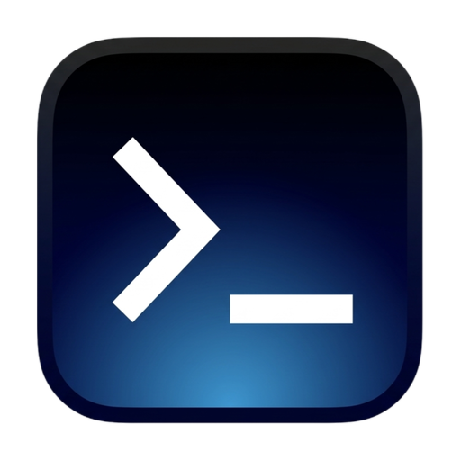

<div align="center">

  

  # ServerDeck — Remote Server Workbench

  macOS desktop app for SSH, terminal tabs, SFTP, server monitoring, and in-app updates.

  [](https://github.com/qfxiongbinbin/serverdeck/releases)
  [](LICENSE)
  [](#)
  [](#)

  Languages: [English](README.md) · [中文](README.zh-CN.md) · [日本語](README.ja.md)

</div>

ServerDeck is a macOS desktop app for remote server workflows, built with Tauri, React, TypeScript, and Rust. The product direction is inspired by tools like Termius, with an initial focus on SSH, terminal tabs, and SFTP browsing.

## Current Scope

- Saved host management with project grouping
- Multi-tab terminal sessions
- SFTP browser with local and remote panes
- File actions for upload, download, and delete
- Server process monitoring (CPU, memory, disk)
- Terminal theme and font size settings
- GitHub Release-based update check and download flow

This repository currently targets macOS first.

## Roadmap

ServerDeck is built as a single-user, local-first server workbench. Instead of chasing feature parity with Termius, the roadmap targets what that class of tool handles poorly for one developer's daily flow: a live `~/.ssh/config` host source, jump host chains, port-forward management, snippets with variables, an SFTP pane that follows the terminal's working directory, tmux-backed persistent sessions, and account-free local sync.

| Milestone | Theme | Planned work |
| --- | --- | --- |
| M1 | Connect | ⌘K quick connect, live `~/.ssh/config` sync with jump host chains, key and known_hosts management, per-host alternate addresses and environment labels |
| M2 | Flow | Port-forward manager, snippets with variables, tmux persistent sessions, split panes and workspace templates |
| M3 | Transfer | SFTP follows the terminal working directory, path bookmarks and transfer queue, remote file editing, directory diff and one-way sync |
| M4 | Extend | CLI, MCP server for external agents, account-free local sync and export, audit history |

Current focus: **M1 — ⌘K quick connect and a live `~/.ssh/config` host source.**

Out of scope by design: team vaults and collaboration, mobile apps, multi-protocol support (Telnet/RDP/VNC), account-based cloud sync, and a built-in AI chat assistant. AI workflows are delegated to external agents through the planned CLI/MCP layer.

Detailed planning is maintained in the internal knowledge base; shipped changes are listed in [`docs/changelog.md`](docs/changelog.md).

## Agent Access & CLI

While the app is running, ServerDeck exposes a same-user local socket
(`~/.serverdeck/agent.sock`, mode `0600`) so scripts and coding agents can reuse
the saved hosts, keys and jump host setup instead of hardcoding connection
details.

```bash
cd ServerDeck
npm run serverdeck -- ping                    # is the app reachable?
npm run serverdeck -- list                    # list saved hosts
npm run serverdeck -- exec <host> -- "df -h"  # run one command over ssh
```

`<host>` accepts a label, address or id, and the CLI exits with the remote
command's exit code. `SERVERDECK_SOCKET` overrides the socket path. An MCP
server built on the same socket is planned next.

## Repository Layout

- `ServerDeck/` — application source
- `ServerDeck/src/` — React UI, theme presets, API wrappers, and styles
- `ServerDeck/src-tauri/` — Rust backend, Tauri config, icons, and desktop commands
- Product and technical planning docs are maintained in the knowledge base under `工作/serverdeck/`
- `docs/release-process.md` — versioning and GitHub Release flow
- `docs/changelog.md` — release notes for each published version

## Local Development

Requirements:

- Node.js `20+`
- Rust toolchain

Run locally:

```bash
cd ServerDeck
npm install
npm run tauri dev
```

Useful commands:

```bash
npm run build                  # frontend build
./node_modules/.bin/tsc --noEmit
cd src-tauri && cargo check
```

## Packaging

Build macOS artifacts:

```bash
cd ServerDeck
npm run tauri build
```

Configured bundle targets include:

- `.app`
- `.dmg`

## Release & Updates

Releases are built from GitHub tags using GitHub Actions. The desktop app checks the latest GitHub Release on startup and shows an `Update` button only when a newer version is available.

Release steps are documented in:

- `docs/release-process.md`

## Notes

- Current GitHub-hosted macOS builds may still require proper Apple signing and notarization for smooth installation on other machines.
- For contributor workflow, see `AGENTS.md`.

## License

This project is licensed under the Apache License 2.0. See `LICENSE`.
